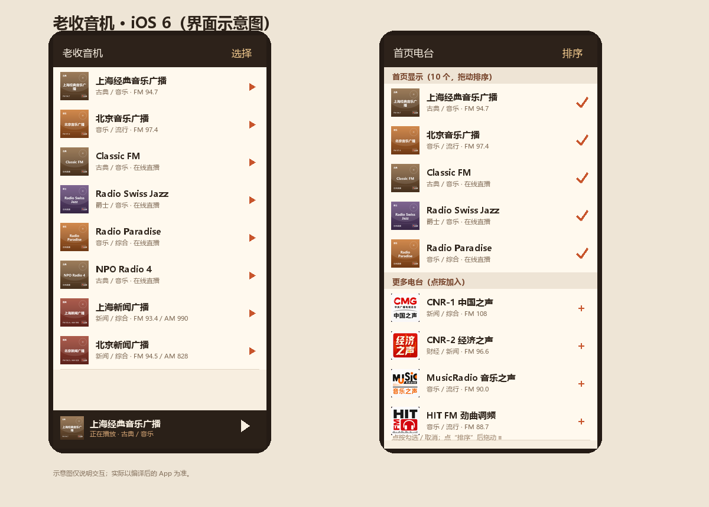

# 老收音机 · iOS 6

一个不依赖 Mac 的 iOS 6 网络收音机源码工程：预装 46 个电台、全部带封面、可勾选首页电台并拖动排序，支持后台音频和锁屏控制。

> 不需要在 App 里复制 JSON，也不需要手动导入。电台数据在 `Resources/Stations.plist`，安装后直接可用。



## 功能

- **预装 46 个电台**：国内新闻/交通/音乐 + 海外音乐台，全部随 App 打包。
- **首页只显示你选中的台**：默认选中 10 个，可随时修改。
- **独立的“首页电台”窗口**：
  - 点右上角“选择”进入；
  - 上半部分“已选”带勾选，下半部分“未选”点按加入；
  - 点“排序”后按住右侧 ≡ 拖动排序；
  - 点“完成”保存，首页立即更新。
- **全部台都有方形封面**：复用原版 8 个台的 logo，其余 38 个为统一风格生成的彩色封面。
- **后台播放**：`UIBackgroundModes = audio`，`AVAudioSessionCategoryPlayback`。
- **锁屏/耳机控制**：播放、暂停（远程控制事件）。
- **iOS 6 兼容**：Objective-C + UIKit，无 Storyboard、无 Auto Layout、无 iOS 7+ API；`armv7`，最低 6.0。

## 目录

```
OldRadio/
  Makefile
  control
  Info.plist
  main.m
  AppDelegate.*
  RadioApplication.*
  Theme.*
  Station.*
  StationStore.*
  RadioPlayer.*
  TransportButton.*
  PlayerBarView.*
  StationCell.*
  StationsViewController.*
  SettingsViewController.*
  PlayerViewController.*
  Resources/
    Stations.plist
    Info.plist
    Icon*.png
    Default*.png
    *.png            # 46 个电台封面
  .github/workflows/build.yml
```

## 用 GitHub Actions 编译（不需要 Mac）

1. 在 GitHub 新建一个仓库；
2. 把 **本目录里的全部文件**（包括 `.github`）上传到仓库根目录；
3. 打开仓库的 **Actions** → **Build OldRadio iOS 6** → **Run workflow**；
4. 等 3–6 分钟，下载 artifact **OldRadio-unsigned-ipa**；
5. 解压得到 `OldRadio-unsigned.ipa`，按你原来的方式签名/安装（AppSync、证书重签等）。

工作流会：

- 在 Ubuntu 上安装 Theos；
- 安装 iOS 9.3 SDK（若不可用则尝试 6.1）；
- 用 `TARGET=iphone:clang:<sdk>:6.0` 编译 `armv7`；
- 打包未签名 IPA。

### 如果 SDK 步骤失败

Theos 的 SDK 仓库/下载地址会变化。失败时：

1. 下载一个 `iPhoneOS6.1.sdk` 或 `iPhoneOS9.3.sdk`；
2. 放到 `$THEOS/sdks/`；
3. 把 `Makefile` 里的 `TARGET` 改成对应 SDK，例如：
   ```make
   TARGET = iphone:clang:6.1:6.0
   ```
4. 重新运行 workflow，或本地执行：
   ```bash
   export THEOS=/path/to/theos
   make clean all FINALPACKAGE=1
   ```

## 本地编译（Theos）

```bash
export THEOS=/path/to/theos
cd OldRadio
make clean all FINALPACKAGE=1
```

产物在 `.theos/` 下，找 `OldRadio.app`，放进 `Payload/` 后 zip 成 IPA。

## 签名与安装

- workflow 产物是**未签名** IPA；
- iOS 6 非越狱设备需要用自己的开发者证书/描述文件重签；
- 越狱设备可用 AppSync 安装；
- Bundle ID 默认 `com.example.oldradio`，重签时按你的证书修改。

## 电台数据

`Resources/Stations.plist`：

```xml
<dict>
  <key>DefaultSelected</key>
  <array>...</array>
  <key>Stations</key>
  <array>
    <dict>
      <key>id</key><string>classicfm</string>
      <key>name</key><string>Classic FM</string>
      <key>genre</key><string>古典 / 音乐</string>
      <key>frequency</key><string>在线直播</string>
      <key>url</key><string>http://media-ice.musicradio.com/ClassicFMMP3</string>
      <key>logo</key><string>classicfm.png</string>
    </dict>
    ...
  </array>
</dict>
```

- `DefaultSelected` 是首次启动的默认首页列表；
- 之后用户在“首页电台”里的勾选/排序保存在 `NSUserDefaults`；
- 想改预装电台，直接改 plist 和 `Resources/` 里的图片。

## 已知限制

- 工程用 iOS 9.3 SDK + 6.0 部署目标编译；这是为了在 GitHub Actions 的 Linux 环境里避开旧版 Xcode。若在真机 iOS 6 上遇到某个系统符号缺失，换 iOS 6.1 SDK 重新编译即可。
- 没有在 iOS 6 真机上实测（当前环境没有设备）；代码只使用 iOS 6 及更早的 API。
- 海外台在部分网络下可能不可达；播放失败时界面会显示“连接失败，点按重试”。
- 电台流地址来自公开网络，可能存在地域/版权限制，仅供个人收听。
